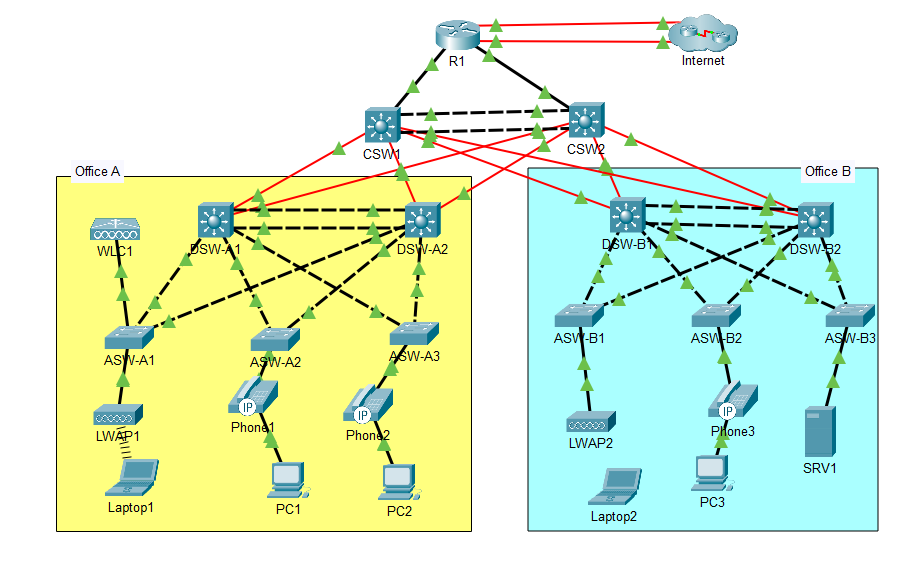
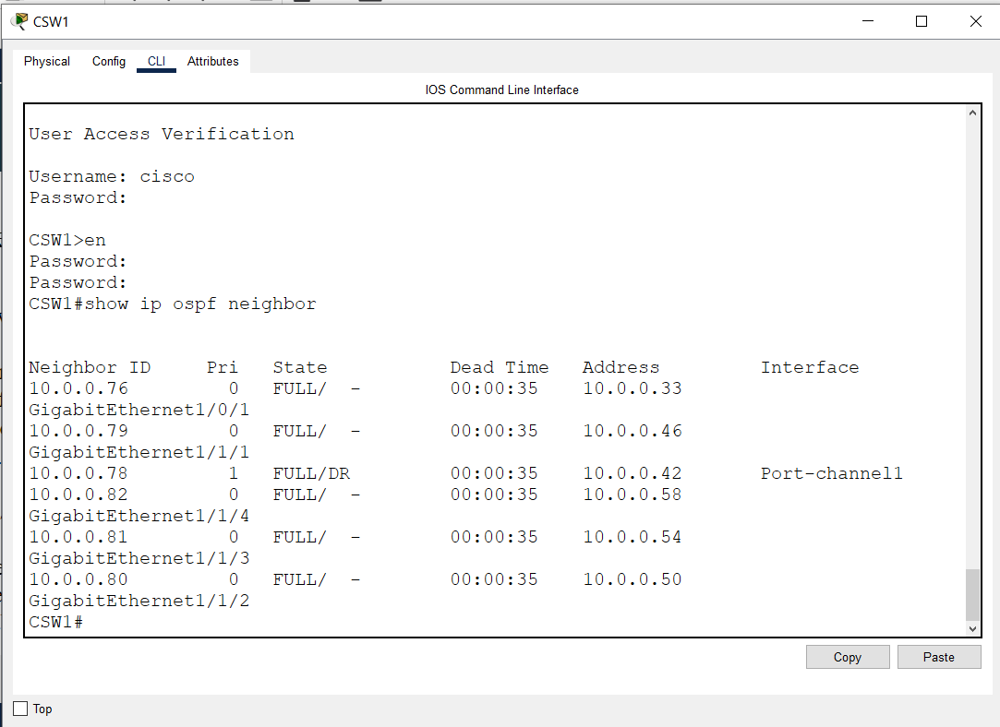
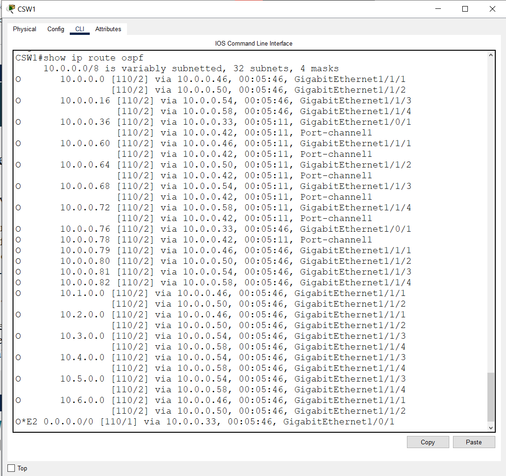
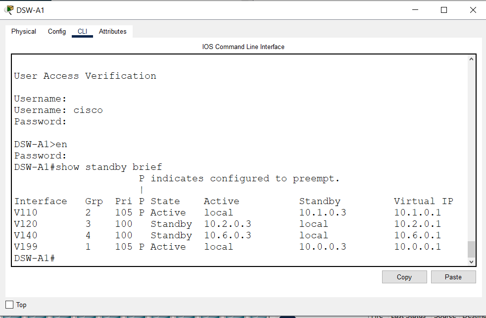
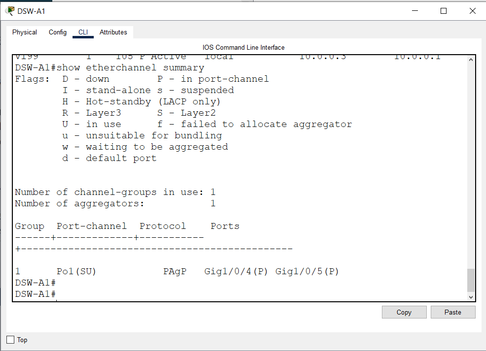
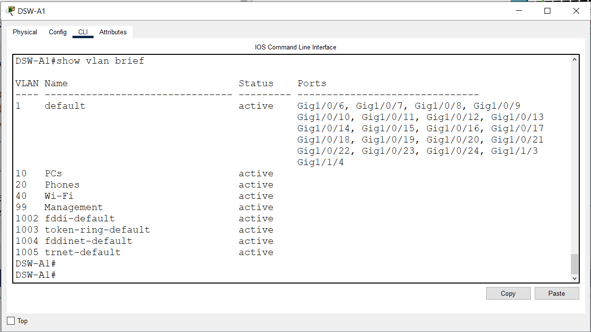
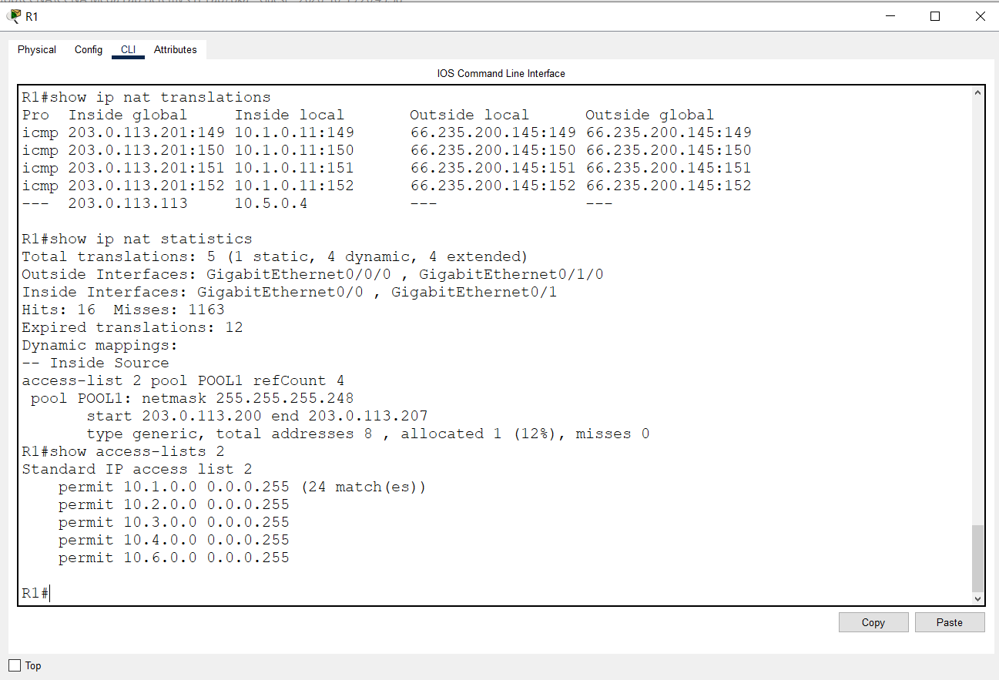
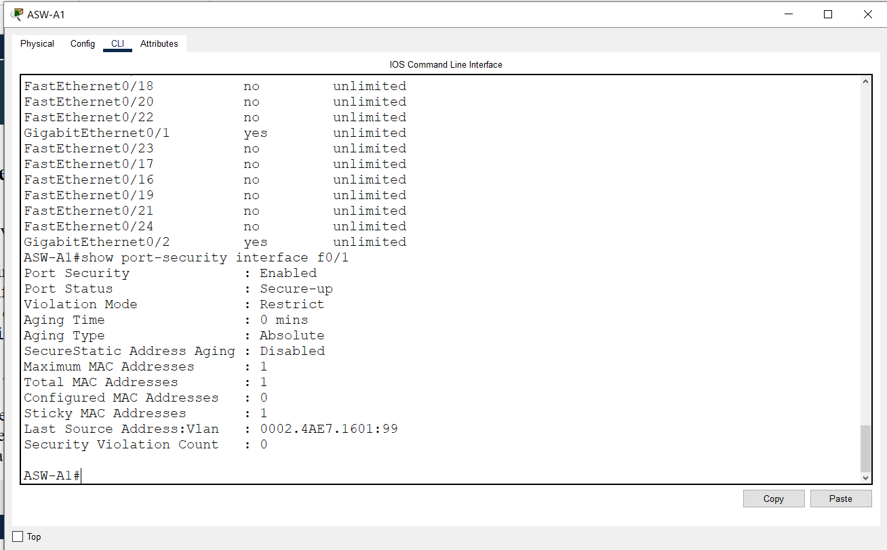
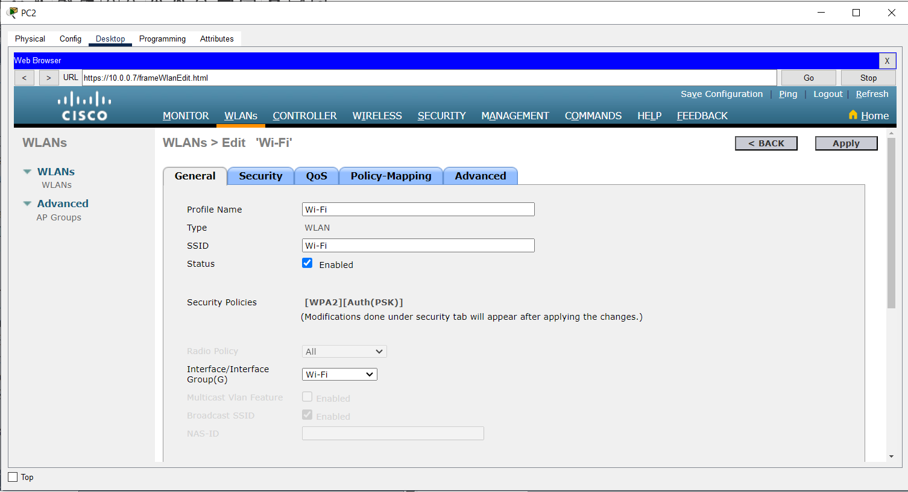
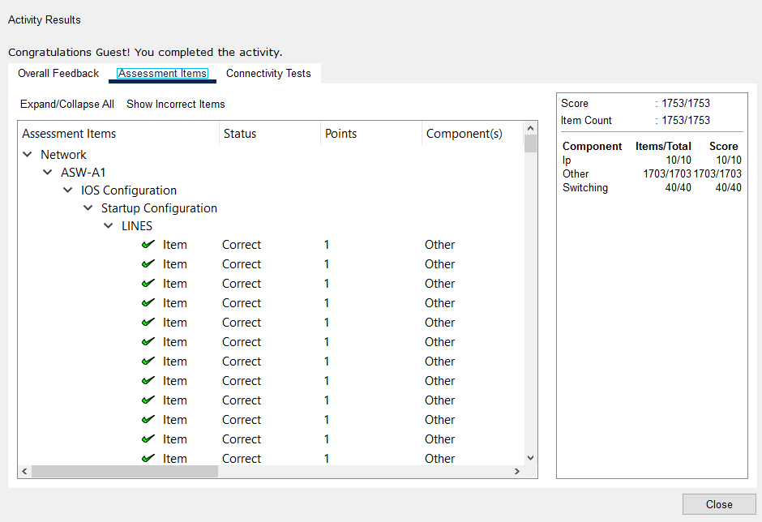

# Enterprise Network Infrastructure — CCNA Mega Lab

**Cisco Packet Tracer | Routing & Switching | High Availability | Network Security | Wireless**

This repository documents my implementation, verification, and troubleshooting of **Jeremy's IT Lab CCNA Mega Lab**. Over roughly two weeks of configuration and troubleshooting, I worked through a guided enterprise network simulation with **two offices**, redundant core and distribution connectivity, and centralized services.

> **Final Packet Tracer assessment: 1,753 / 1,753 — 100%**

The original topology and requirements are from **Jeremy's IT Lab**. My contribution was configuring, testing, debugging, and documenting the lab. The assessment score reflects the Packet Tracer activity, not production deployment or a Cisco certification.

## 1. Network architecture

| Layer / Function | Devices |
| --- | --- |
| Internet edge | R1, dual ISP links |
| Core | CSW1, CSW2 |
| Distribution | DSW-A1, DSW-A2, DSW-B1, DSW-B2 |
| Access | ASW-A1–A3, ASW-B1–B3 |
| Clients and services | PCs, IP phones, SRV1, WLC1, two lightweight APs |

## 2. Technologies implemented

| Domain | Configuration and features |
| --- | --- |
| Layer 2 | VLAN segmentation, trunking, VTPv2, Rapid PVST+, PAgP and LACP EtherChannel |
| Layer 3 | IPv4/IPv6, single-area OSPF, static and floating default routes |
| Redundancy | HSRPv2, redundant uplinks, Internet link failover testing |
| Services | DHCP and DHCP relay, DNS, NAT/PAT, NTP, SNMP, Syslog, FTP, SSH |
| Security | ACLs, Port Security, DHCP Snooping, Dynamic ARP Inspection |
| Wireless | WLC-based WLAN, lightweight access points, WPA2/AES with PSK |

## 3. Verification evidence

### OSPF adjacencies and learned routes

CSW1 has **six OSPF neighbors in the FULL state** across the backbone.

The routing table shows OSPF-learned paths toward both offices.

### HSRP and EtherChannel

In Office A, DSW-A1 is Active for VLANs **10 and 99**, and DSW-A2 is Active for VLANs **20 and 40**.

The Office A distribution EtherChannel shows **Po1(SU)** and bundled physical member links **(P)** using PAgP.

### VLAN segmentation

### Static NAT and dynamic PAT

R1 shows a static mapping between SRV1 (`10.5.0.4`) and `203.0.113.113`, plus dynamic PAT translations for traffic from Office A.

### Access security

The access-switch screenshot verifies **Port Security**, **restrict** violation mode, and a learned sticky MAC address. DHCP Snooping and DAI were also configured as part of the lab; they are not directly verified by this particular screenshot.

### Wireless controller

The WLC GUI shows an enabled `Wi-Fi` SSID using WPA2/PSK security.

## 4. Final assessment

| Category | Score |
| --- | ---: |
| IP | 10 / 10 |
| Other | 1,703 / 1,703 |
| Switching | 40 / 40 |
| **Total** | **1,753 / 1,753 (100%)** |

## 5. Troubleshooting highlights

| Symptom | Root cause | Fix |
| --- | --- | --- |
| PC1 could reach the server VLAN gateway, but not SRV1 | Incorrect server IP `10.0.5.4` | Corrected to `10.5.0.4` |
| DSW-B1 was Standby on management VLAN 99 | Missing HSRP priority setting | Set group 1 priority to 105 |
| ASW-A1 assessment flagged access-port STP settings | PortFast and BPDU Guard missing on F0/1 | Applied commands and saved startup-config |
| DSW-A1 assessment flagged OSPF VLAN 40 | VLAN 40 not passive | Added `passive-interface vlan 40` |

More detail: [Troubleshooting notes](docs/troubleshooting.md).

## 6. Repository files

- [Configuration reference](configurations/Mega_Lab_commands.txt) — command notes grouped by lab part and device. **This is a consolidated study reference, not a full device configuration export.**
- [Troubleshooting notes](docs/troubleshooting.md) — problems, checks, and resolutions.
- [Screenshots](screenshots/) — topology and selected validation evidence.

## 7. Tools and scope

**Tools:** Cisco Packet Tracer, Cisco IOS CLI, Git, GitHub.

This is a guided **network simulation**, not an independently designed or production-deployed enterprise network. Simulator features and behavior can differ from actual Cisco hardware.

## Credits

- **Original lab:** [Jeremy's IT Lab](https://www.jeremysitlab.com/) — CCNA Mega Lab.
- **Implementation, troubleshooting, and documentation:** Ayoub Briouel.

Please obtain the original activity from its authorized source; the project documentation here describes my implementation.
